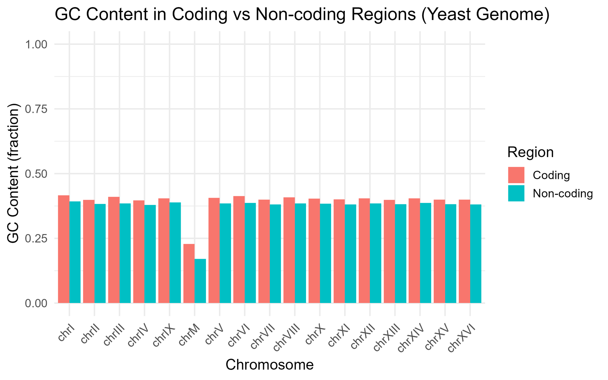
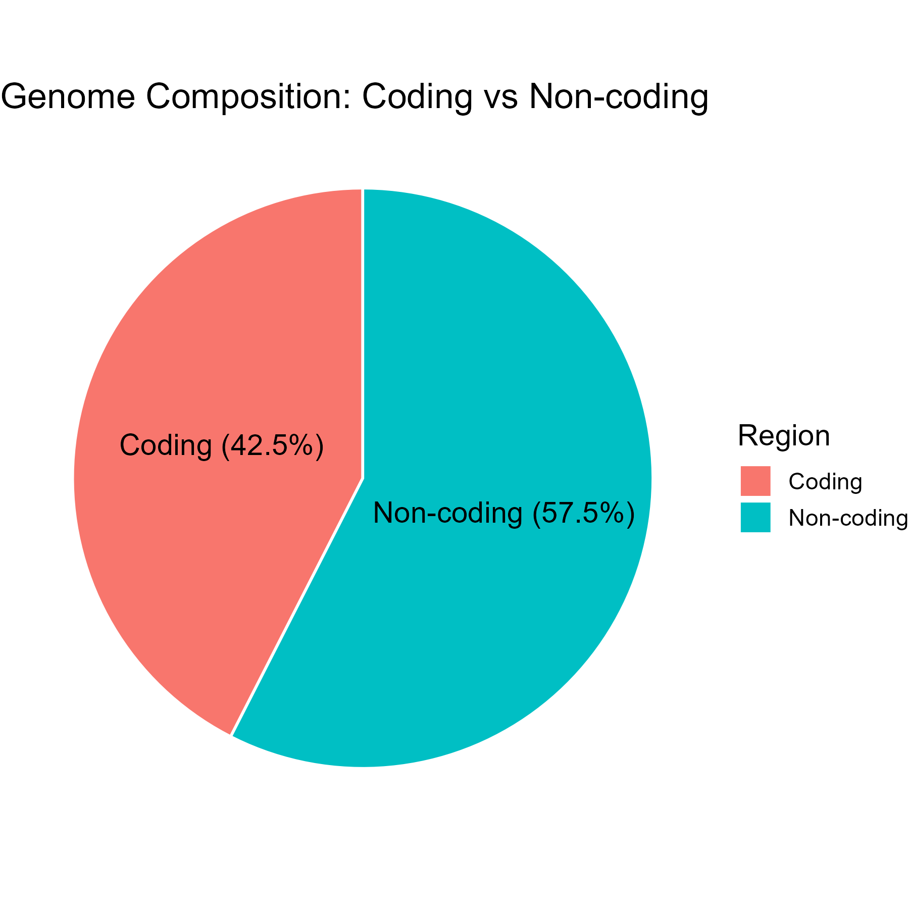

## TL;DR

My first independent genomics project asked two simple questions about baker's yeast (*Saccharomyces cerevisiae*): how much of the genome codes for proteins, and is coding DNA richer in G and C? The GC result holds up: **coding DNA has more GC** (about 40%) than the genome as a whole (about 38%). But my headline number, "**42.5% of the genome is coding**", is wrong. A one-line strand mismatch made every chromosome count as "non-coding". The corrected answer is **72.6%**. Code is on [GitHub](https://github.com/mdabrarfaiyaj/yeast-genome-analysis).

## Why yeast

Yeast is the friendliest genome to start with: small (about 12 million bases), well-annotated, and available directly in R through Bioconductor. I wanted to learn how to load a genome, pull out gene positions, and calculate something real.

## What I did

1. Loaded the yeast genome (sacCer3) and its gene annotation in R.
2. For each chromosome, took the protein-coding regions (CDS) and merged overlaps.
3. Defined "non-coding" as **the chromosome minus the coding regions**.
4. Calculated GC content for both, and made plots.

## What still holds: coding DNA is GC-richer


_GC content per chromosome. (Read the "non-coding" bars as "whole chromosome"; see below.)_

On every nuclear chromosome, coding DNA had a higher GC content (about **40%**) than the chromosome as a whole (about **38%**). That fits what's known about yeast: genes tend to be richer in G and C than the DNA between them.

The **mitochondrial chromosome** stood out with very low GC (about 17% overall, 23% in its coding parts). Mitochondria have their own small genome with a very different history.

## The bug

{: width="380" .right}

A year later, while preparing this blog, I re-read my results table. The "non-coding" length of chromosome I was **230,218 bases**. That's the length of the *entire* chromosome. Something was off.

Here's what happened. In GenomicRanges, every range has a **strand**: `+`, `-` or `*` (no strand). My chromosome range had no strand (`*`), but the genes did (`+` or `-`). When I subtracted the genes from the chromosome, R treated them as being on different strands, so **nothing was subtracted**. My "non-coding" DNA was actually the whole chromosome.

```r
# What I wrote: strands don't match, so nothing is removed
noncoding <- setdiff(chr_range, reduce(cds_chr))

# What it should be: ignore strand when asking "is this base coding?"
noncoding <- setdiff(chr_range, reduce(cds_chr, ignore.strand = TRUE))
```

### What changes

- **Coding share:** not 42.5% but **72.6%**. That matches the textbook picture of yeast as a very compact genome with genes packed closely together.
- **Non-coding GC:** the real value is **lower** than the ~38% I reported, because I was averaging coding and non-coding DNA together. A rough estimate from my own table puts it closer to a third.
- **The main conclusion** (coding DNA is GC-richer) gets **stronger**, not weaker.

## An analogy: counting parks in Dhaka

Imagine you want to know how much of Dhaka is buildings and how much is open space. You take the map, subtract the buildings, and call what's left "open space". But your buildings were drawn on a different layer from the map, so the subtraction did nothing. You'd conclude that all of Dhaka is open space, which anyone stuck in Farmgate traffic knows is false.

That is exactly what my strand mismatch did.

## What I learned

- **Sanity-check every number against something you know.** Yeast is famously gene-dense. "Only 42.5% coding" should have made me stop.
- **Look at the raw table, not just the plots.** The pie chart looked fine. The table showed the problem.
- **Strand is not a detail.** In genomics, many silent bugs come from strand handling.
- **Old projects are worth re-reading.** Finding your own bug is uncomfortable, but it's real progress.

The fix is a one-line change, shown above.

## Conclusion

My first genome project got the biology half right and the arithmetic wrong, and I only saw it a year later. That's fine. The habit I took away, checking numbers against what's already known, has saved me several times since.

## Citations

1. Goffeau A, Barrell BG, Bussey H, et al. Life with 6000 genes. *Science*. 1996;274(5287):546–567.
2. Lawrence M, Huber W, Pagès H, et al. Software for computing and annotating genomic ranges. *PLOS Computational Biology*. 2013;9(8):e1003118.
3. Bioconductor packages BSgenome.Scerevisiae.UCSC.sacCer3 and TxDb.Scerevisiae.UCSC.sacCer3.sgdGene.
