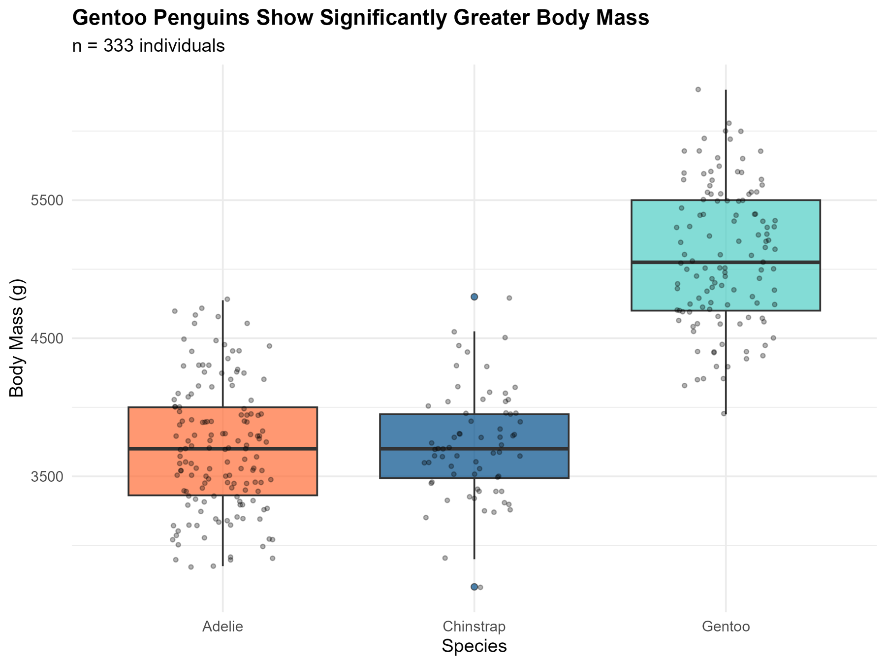
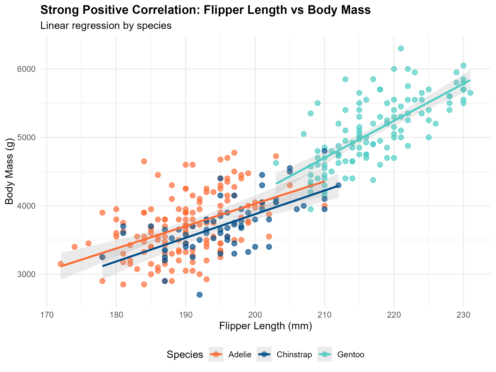
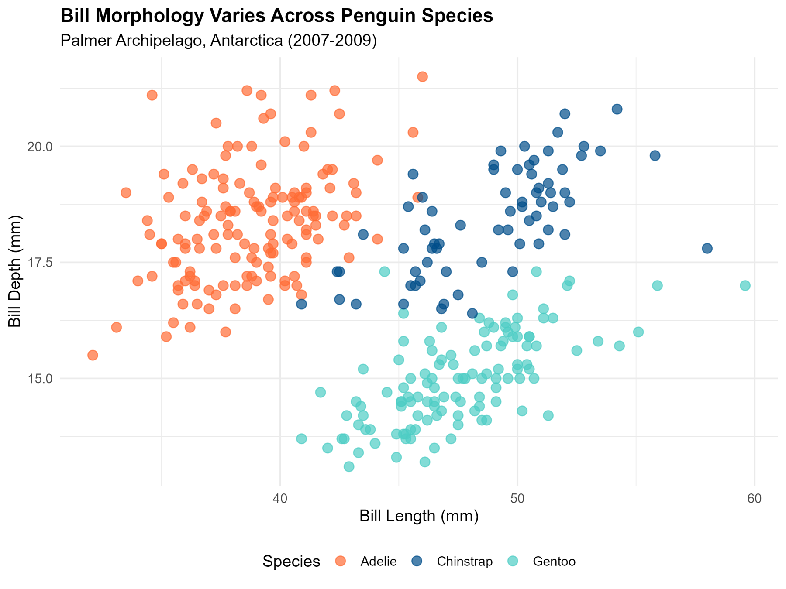

## TL;DR

This was my first statistics project in R: three penguin species from Antarctica, four body measurements, and some classic tests. Gentoo penguins are about **1.4 kg heavier** than the other two species, and flipper length tracks body mass very closely (r = 0.87). But the most interesting result is one I misread at first: across all penguins, longer bills look **shallower** (r = −0.23), yet **within every species, longer bills are deeper** (r = +0.39 to +0.65). That flip is called **Simpson's paradox**. Code is on [GitHub](https://github.com/mdabrarfaiyaj/01-penguins-biological-data-analysis).

## Why I picked this

Before analysing genomes, I wanted the basics to feel solid: cleaning data, checking assumptions, running ANOVA and correlations, and making clear figures. The Palmer Penguins dataset is small, clean, real field data, and perfect for practice.

## The data

The data was collected at Palmer Station, Antarctica, between 2007 and 2009 (Gorman et al., 2014). It covers three species:

- **Adélie** (*Pygoscelis adeliae*)
- **Chinstrap** (*Pygoscelis antarcticus*)
- **Gentoo** (*Pygoscelis papua*)

For each penguin: bill length, bill depth, flipper length, body mass, sex, island and year. After removing rows with missing values, **333 penguins** remained.

## What I found

### 1. Gentoo penguins are in a different weight class

_Body mass by species._

| Species | Penguins | Average body mass |
|---|---|---|
| Adélie | 146 | 3,706 g |
| Chinstrap | 68 | 3,733 g |
| Gentoo | 119 | 5,092 g |

A one-way ANOVA confirmed that species matters a lot (F = 342, p < 0.001). Species explains about **67% of the variation** in body mass. The follow-up test (Tukey) showed:

- **Gentoo vs. the others:** about 1,360–1,390 g heavier (p < 0.001)
- **Chinstrap vs. Adélie:** only 27 g apart, **not a real difference** (p = 0.92)

So there are two size groups, not three.

### 2. Bigger penguins have longer flippers

_Body mass against flipper length._

Flipper length and body mass have a very strong correlation (**r = 0.87**). A bigger body needs bigger flippers to swim.

### 3. The paradox

_Bill length against bill depth, coloured by species._

If you put all penguins together, bill length and bill depth have a weak **negative** correlation (r = −0.23). Longer bills seem shallower.

In my first write-up, I explained this as a "trade-off": a longer bill gives up some depth. **That was wrong.** Look at each species on its own:

| Species | Bill length vs. depth |
|---|---|
| Adélie | **+0.39** |
| Chinstrap | **+0.65** |
| Gentoo | **+0.65** |

Inside every species, longer bills are **deeper**, not shallower. The negative trend only appears when you mix the species, because Gentoos have long but thin bills while Adélies have short but deep bills. The difference *between* species hides the pattern *within* them.

## An analogy: the fish bazaar

Go to a Dhaka fish market. For ilish, a bigger fish costs more per kilo. For rui, a bigger fish also costs more per kilo. Inside each fish type, **bigger means more expensive**.

But rui are usually bigger than ilish and much cheaper per kilo. If you mix all the fish into one chart, you get the opposite rule: **bigger fish look cheaper**. Every shopkeeper knows that's nonsense, because you have to compare ilish with ilish.

Penguin species are the ilish and the rui.

## What I learned

- **Check your assumptions before the test** (normality, equal variance), and report effect sizes, not just p-values.
- **Always look inside the groups.** A trend in pooled data can disappear or flip within each group.
- **Re-read old work.** My first explanation sounded biological and reasonable. It was still wrong, and I only saw it by splitting the data by species.

## Conclusion

A simple dataset of 333 penguins taught me one of the most important ideas in data analysis: the whole can tell a different story from its parts. Whether it's penguins, fish prices or cancer patients from different hospitals, compare like with like.

## Citations

1. Gorman KB, Williams TD, Fraser WR. Ecological sexual dimorphism and environmental variability within a community of Antarctic penguins (genus *Pygoscelis*). *PLOS ONE*. 2014;9(3):e90081.
2. Horst AM, Hill AP, Gorman KB. palmerpenguins: Palmer Archipelago (Antarctica) penguin data. R package version 0.1.0. 2020. doi:10.5281/zenodo.3960218
