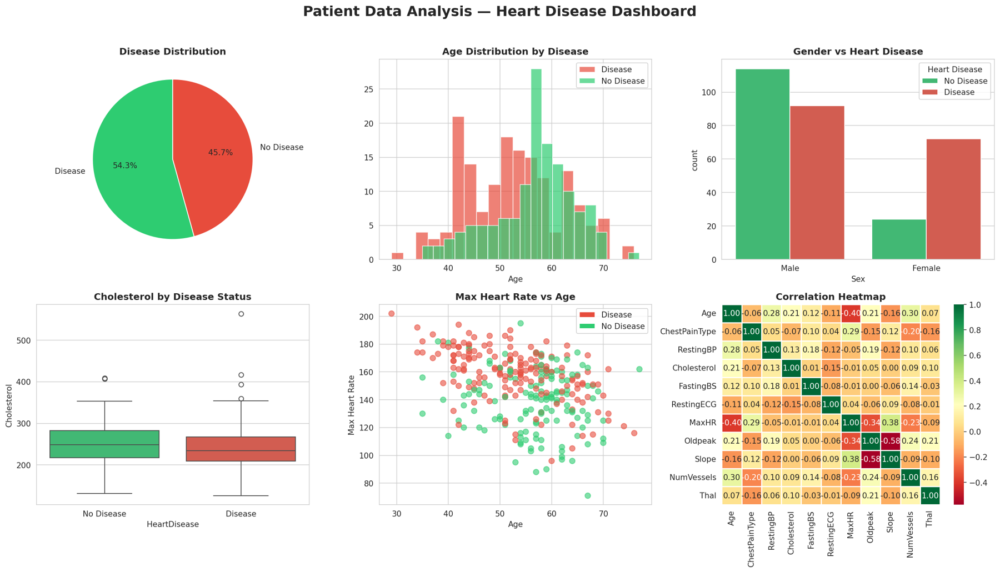

## TL;DR

I analysed a popular heart disease dataset with Python and SQL. Two surprises came out. First, the "1,025 patients" are really **302 unique patients**, each copied about three times. Second, the patients labelled "Disease" were **younger, reached higher heart rates and were mostly women**, which is the opposite of what cardiology says. When I compared the numbers with the original study, the most likely explanation is simple: **the disease labels in this version of the dataset are reversed.** Code is on [GitHub](https://github.com/mdabrarfaiyaj/patient-data-analysis).

## Why I picked this

I wanted to practise basic data skills outside of genomics: cleaning a table, writing SQL queries, and building a dashboard in Python. The UCI heart disease dataset is everywhere on Kaggle, so it seemed like a safe place to start.

It turned out not to be safe at all, which made it a much better lesson.

## An analogy: the strange thermometer

Imagine a thermometer that shows your feverish patients as the coldest people in the room. You wouldn't write a paper saying "fever lowers body temperature." You would check the thermometer.

That is what happened here.

## What I did

1. **Loaded the data** (14 columns: age, sex, cholesterol, maximum heart rate, chest pain type and so on, plus a 0/1 "target").
2. **Removed duplicates.** 1,025 rows became **302 unique patients**. Without this step, every count would be inflated about three times.
3. **Stored it in SQLite** and answered questions with SQL (disease rate, age by group, sex by group).
4. **Built a six-panel dashboard** with Matplotlib and Seaborn.

## What I found

_The six panels: disease share, age, sex, cholesterol, maximum heart rate vs. age, and correlations._

Taking the label as written (1 = disease), here is what the data says:

| | "Disease" (n = 164) | "No disease" (n = 138) |
|---|---|---|
| Average age | 52.6 years | 56.6 years |
| Average max heart rate | 158 bpm | 139 bpm |
| Women in the group | 72 | 24 |

Read that table as a doctor would, and every row is backwards:

- Heart disease usually comes with **older** age, not younger.
- People with heart disease usually reach a **lower** maximum heart rate during exercise, because a damaged heart can't speed up as much.
- In the original clinical study, **women were less likely** to have disease than men.

### Checking the thermometer

This dataset is a version of the classic **Cleveland heart disease study** (Detrano et al., 1989). In the original data, **164 patients had no disease and 139 had disease**.

In the Kaggle version, the group labelled "Disease" has exactly **164** patients. And 24 of 96 women are in the "No disease" group here, which is about the share of women *with* disease in the original study.

So the simplest explanation is that **0 and 1 were swapped** somewhere when this version was made. Many people on Kaggle have noticed the same thing.

If you flip the labels, everything lines up with medicine: the disease group becomes older, has lower maximum heart rates, and has more men.

### One finding survives either way

**Cholesterol hardly separated the two groups** in this data. That's true whichever way the labels go. Cholesterol matters for heart disease over a lifetime, but in a group of patients who were *already* being tested for chest pain, it wasn't a useful sign on its own.

## What I learned

- **Duplicates are silent.** A dataset can look three times bigger than it is.
- **Never trust a 0/1 column without checking it against the source.** A swapped label doesn't cause an error message. It just quietly reverses your conclusions.
- **When data disagrees with well-established science, suspect the data first.** Sometimes the surprise is a real discovery. Much more often, it's the thermometer.

My original write-up explained the results using textbook knowledge, without noticing that my own numbers said the opposite. Writing this post, and comparing every number again, is how I caught it.

## What this can't tell us

- 302 patients from one hospital study in the 1980s is a **small, old sample**.
- All patients were **already being tested** for heart problems, so this is not the general population.
- I can't be 100% sure *where* the labels were swapped, only that the evidence strongly points to it.

## Conclusion

My first "finding" was that sick people were younger and fitter. My real finding was that the labels were upside down. That's not a failure; it's the most useful thing this project taught me. Before you explain a surprising result, check the thermometer.

## Citations

1. Detrano R, Janosi A, Steinbrunn W, et al. International application of a new probability algorithm for the diagnosis of coronary artery disease. *American Journal of Cardiology*. 1989;64(5):304–310.
2. Janosi A, Steinbrunn W, Pfisterer M, Detrano R. Heart Disease [Dataset]. UCI Machine Learning Repository. 1988.
