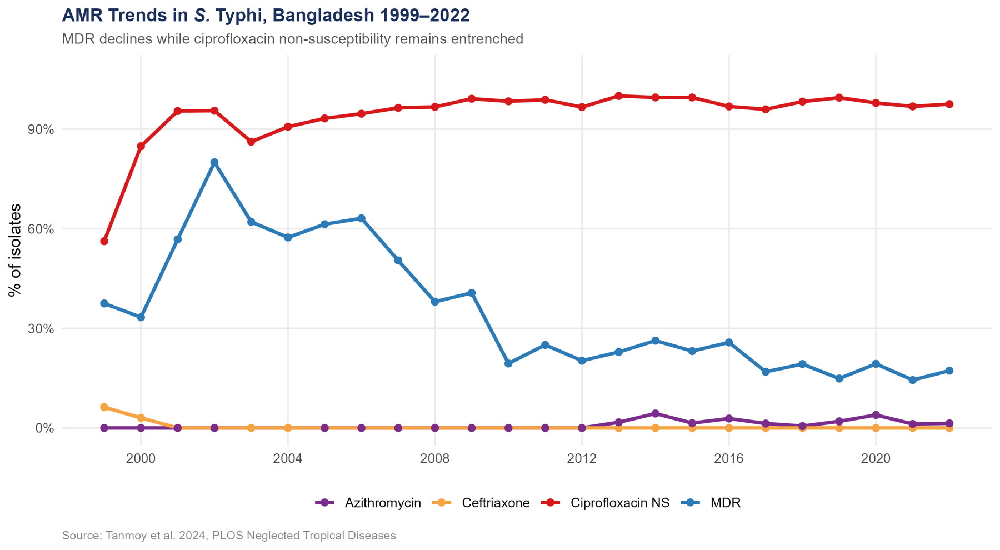
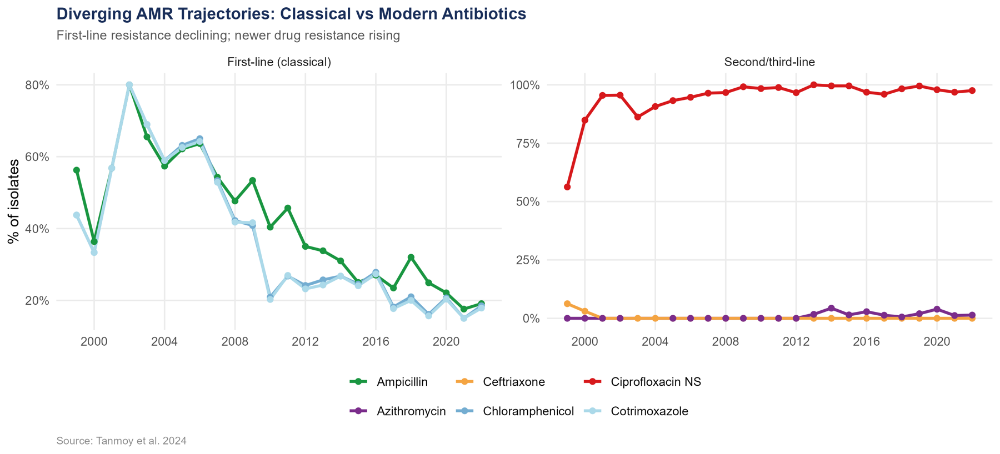
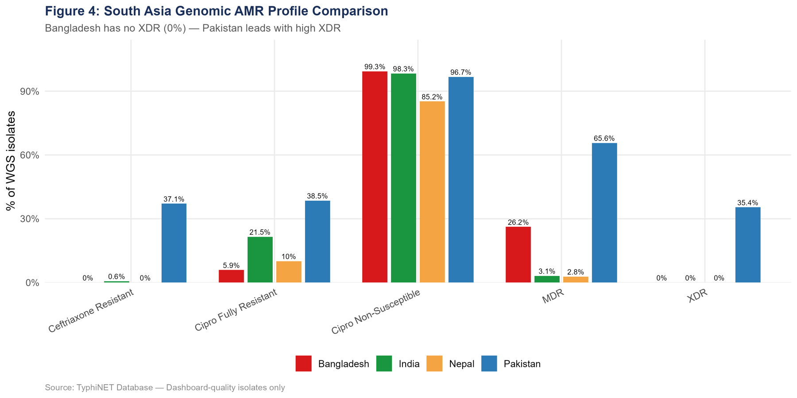
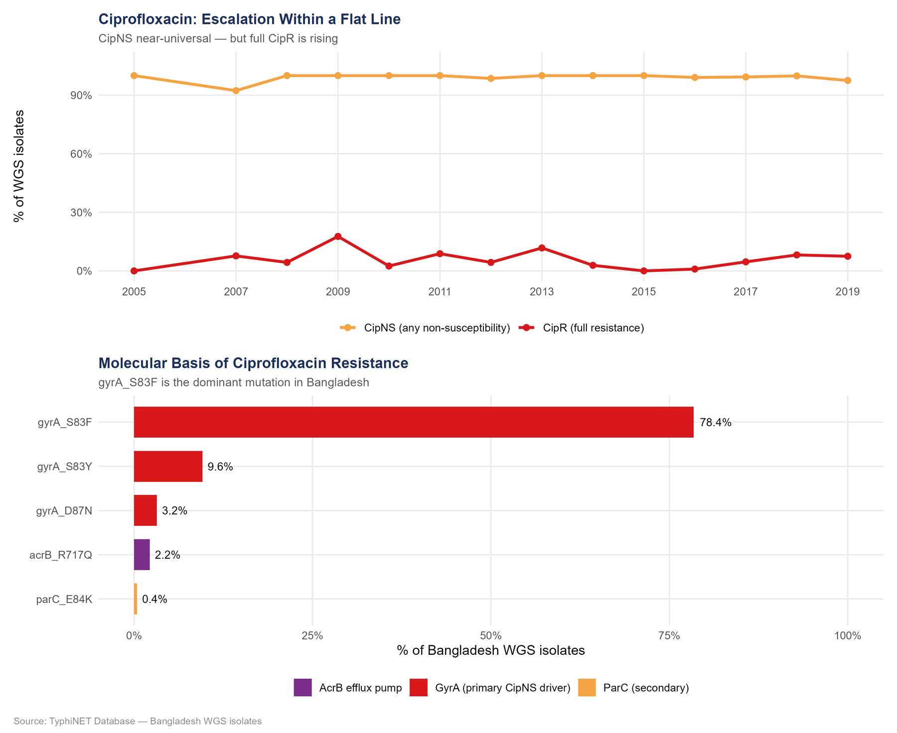

## TL;DR

Typhoid bacteria in Bangladesh became **less multidrug-resistant** between 1999 and 2022. That sounds like progress. But when I reanalysed 12,435 patient isolates from Dhaka and 1,664 bacterial genomes, a different picture appeared: resistance to the **old** drugs fell because we stopped using them, while resistance to the **drugs we use today** stayed high or kept rising. Code is on [GitHub](https://github.com/mdabrarfaiyaj/Typhoid-Fever-in-Bangladesh), with an [interactive dashboard](https://u3j9z9-md0abrar-faiyaj.shinyapps.io/typhoid-amr-bangladesh/) and a [full report](https://mdabrarfaiyaj.github.io/Typhoid-Fever-in-Bangladesh/).

## Why I picked this

Typhoid is not a textbook disease in Bangladesh. Most of us know someone who has had it. In October 2025, Bangladesh launched a nationwide typhoid conjugate vaccine campaign to reach about **50 million children**. Part of the evidence behind that decision was a 24-year study by scientists at the Child Health Research Foundation (CHRF) in Dhaka (Tanmoy et al., 2024).

Their raw data is public. I wanted to see whether I could rebuild their argument myself, and then add the genomic side from the global TyphiNET database.

## The problem: a ladder of antibiotics

Think of typhoid treatment as a **ladder**:

1. **Bottom steps (old, cheap drugs):** ampicillin, chloramphenicol, cotrimoxazole. A bacterium resistant to all three is called **MDR** (multidrug-resistant).
2. **Middle steps:** ciprofloxacin (oral).
3. **Top steps:** ceftriaxone (injection) and azithromycin (oral).

If the top steps break, there is no step left to climb to.

## An analogy: old mobile phones

In Dhaka, almost nobody carries a button phone any more. Fewer button phones doesn't mean phone problems are solved. It means everyone moved to smartphones, and now the smartphones get the cracked screens.

MDR in typhoid is the button phone.

## What I did

**Layer 1: what doctors see (12,435 isolates, 1999–2022).** For each year and each antibiotic, I calculated the share of resistant isolates, fitted a linear trend, and summarized five surveillance periods.

**Layer 2: why it happens (1,664 Bangladeshi genomes).** From TyphiNET, I looked at resistance mutations (in genes like *gyrA*), compared Bangladesh with India, Nepal and Pakistan, and followed fully ciprofloxacin-resistant strains over time.

Everything is in R, with a Quarto report and a Shiny dashboard.

## What I found

### 1. MDR fell, but ciprofloxacin resistance never moved

_Share of resistant isolates per year, Dhaka, 1999–2022._

- **MDR** peaked in the early 2000s (over 60% in several years) and fell to about **17% by 2022**, losing about 2 percentage points per year.
- **Ciprofloxacin non-susceptibility** has been **above 93% every year since 2005**.

So the "improvement" in MDR happened while the next drug on the ladder was already failing.

### 2. Two directions at once

_Old drugs (left) vs. current drugs (right)._

All three old drugs show **falling** resistance (about −2% per year each). The drugs used today show the opposite:

- **Ciprofloxacin:** slightly **rising** (+0.7% per year), from an already very high level
- **Azithromycin:** still low (a few percent), but **rising** (+0.12% per year, statistically significant)
- **Ceftriaxone:** close to zero, which is the one piece of real good news

The problem wasn't solved. It moved up the ladder.

### 3. Bangladesh is not Pakistan... yet

_Genomic resistance in Bangladesh, India, Nepal and Pakistan (TyphiNET)._

**XDR** (extensively drug-resistant) typhoid resists the old drugs, ciprofloxacin and ceftriaxone. In the genome data:

- **Pakistan:** **35.4%** of genomes are XDR, after a large outbreak that started in 2016
- **Bangladesh:** **0%**

That gap is the good news. The worry is that Pakistan got there by climbing the same ladder Bangladesh is on now.

### 4. One mutation explains the ciprofloxacin problem

_Ciprofloxacin resistance and gyrA mutations in Bangladeshi genomes._

A single change in the *gyrA* gene, **S83F**, is present in **78% of all Bangladeshi genomes**. That one mutation is enough to make the bacteria less sensitive to ciprofloxacin, which explains why culture results have been so bad for so long. Full resistance needs a second mutation, and strains carrying it rose from **0.9% in 2016 to 8.2% in 2018**. The flat line in Figure 1 hides a problem that is still getting worse inside it.

## What this means

When the drugs that remain are under pressure, the long-term answer is **prevention**. That was the authors' argument, and it fits the decision to vaccinate. My reanalysis reaches the same conclusion from the same public data.

## What this can't tell us

- The isolates come from **Dhaka hospitals**, not the whole country.
- **Trends are straight lines.** Real resistance doesn't always change linearly, and some early years have few isolates.
- The genome data has **uneven sampling by year** (most come from 2017–2018, and they stop in 2019), so year-to-year genomic trends are rough.
- This is a **reanalysis**. The original authors did the hard work of collecting the data.

## Conclusion

Falling MDR in Bangladesh looks like a success, but mostly it is the button phone disappearing. The real fight has moved to ciprofloxacin, azithromycin and ceftriaxone, the top of the ladder, where we cannot afford to lose another step.

## Citations

1. Tanmoy AM, Hooda Y, Sajib MSI, et al. Trends in antimicrobial resistance amongst *Salmonella* Typhi in Bangladesh: a 24-year retrospective observational study (1999–2022). *PLOS Neglected Tropical Diseases*. 2024;18(10):e0012558.
2. Tanmoy AM, et al. *Salmonella enterica* serovar Typhi in Bangladesh: exploration of genomic diversity and antimicrobial resistance. *mBio*. 2018;9:e02112-18.
3. TyphiNET database. [typhi.net](https://www.typhi.net/)
4. UNICEF Bangladesh. Bangladesh launches nationwide typhoid conjugate vaccine campaign to protect 50 million children. October 2025.
