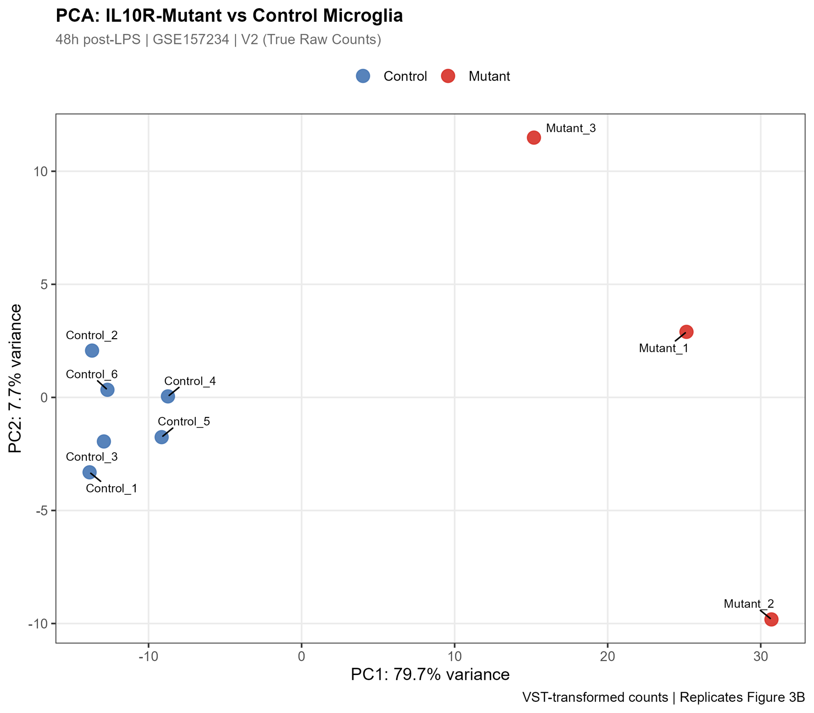
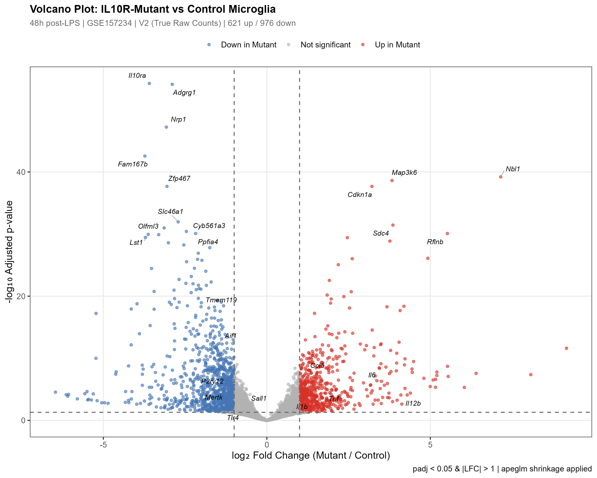
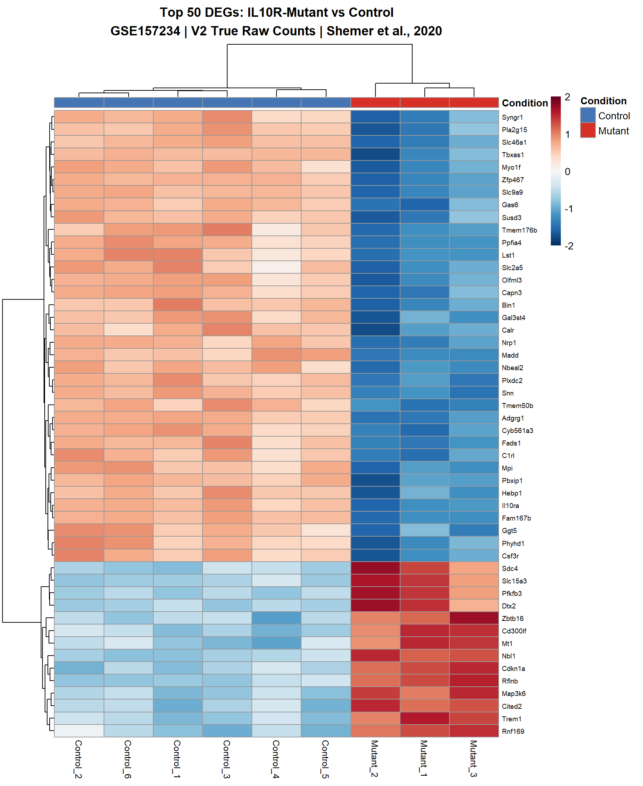

## TL;DR

I reproduced an RNA-seq result from a published *Immunity* paper about brain immune cells (microglia). My first version fed **already-normalized** counts into DESeq2, which normalizes them again. So I went back to the raw reads, rebuilt the pipeline from FASTQ files, and found **1,597 differentially expressed genes**, close to the paper's 1,647, with the key immune genes moving in the right direction. Everything is in an interactive Shiny dashboard. Code is on [GitHub](https://github.com/mdabrarfaiyaj/rna-seq-shiny-pipeline), with the [live dashboard](https://019cd22f-689b-acc2-4b56-472725ef4a7b.share.connect.posit.cloud/) and a [Zenodo record](https://doi.org/10.5281/zenodo.19138922).

## The biology: brain immune cells that can't calm down

**Microglia** are the immune cells of the brain. When there is an infection somewhere in the body, they react. Normally, a signal called **IL-10** tells them to calm down again afterwards.

Shemer et al. (2020) studied mice whose microglia **cannot sense IL-10** (they lack the IL-10 receptor). After an immune challenge (LPS), these microglia stay switched on, produce too much TNF, and damage neurons.

My question was simple: **which genes stay "on" in microglia that can't hear IL-10, 48 hours after the challenge?**

## Version 1: the mistake

The paper's GEO entry only offered one count file: counts that had **already been normalized** by the authors' pipeline. I used it as input for DESeq2.

The problem: **DESeq2 expects raw counts.** It does its own normalization. Giving it normalized counts means normalizing twice.

Here's the analogy. Your mother has already salted the curry. You don't know that, so you add salt again. The dish still looks like curry, and from far away it might even taste fine. But it's not the dish the recipe describes.

My V1 results looked reasonable (1,563 genes), but I couldn't defend the method. So I documented the limitation and started again.

## Version 2: from raw reads

The raw sequencing reads were on SRA, so I built the whole pipeline in Galaxy and R:

1. **Download** FASTQ files for 9 samples (3 mutant, 6 control, all 48 h after LPS)
2. **Quality check** with FastQC and MultiQC
3. **Trim** adapters and low-quality bases (Trimmomatic)
4. **Align** to the mouse genome (HISAT2, mm10)
5. **Count** reads per gene (featureCounts)
6. **Test** for differences with DESeq2 (padj < 0.05 and |log2 fold change| > 1), using apeglm shrinkage
7. **Visualize** in a Shiny dashboard: volcano plot, PCA, heatmap and a searchable table

I also checked the sample order by reading the actual file header, not by assuming it. A swapped label would silently ruin everything.

## What I found

### Mutant and control microglia separate cleanly

_PCA of the 9 samples. Mutant and control samples form separate groups._

The first quality check passed: mutant and control samples form two clear groups, as in the paper's Figure 3B.

### 1,597 genes change

_Each dot is a gene. Right = higher in mutant; up = more significant._

| Version | Input | Up | Down | Total |
|---|---|---|---|---|
| Paper (Fig. 3E) | authors' internal raw counts | 954 | 693 | 1,647 |
| My V1 | normalized counts from GEO | 669 | 894 | 1,563 |
| **My V2** | **raw reads from SRA** | **621** | **976** | **1,597** |

The total is close to the paper's. The up/down split is different, and I think there are three honest reasons for that:

- **Different counting.** The paper counted reads near the 3' end of genes (their sequencing method needs that). I counted all exons.
- **Different shrinkage.** The paper used an older DESeq2 option; I used the current one (apeglm).
- **Possibly different samples.** The paper may have used samples that are not in the public upload.

### The key genes move the right way

The genes that matter most for the biology behave as expected:

- **Strongly up in mutant microglia:** *Tnf* (the damaging signal from the paper), *Il6*, *Il12b*, *Ccl5*. These are inflammation genes: the microglia are stuck "on."
- **Down in mutant microglia:** *Tmem119* and *P2ry12*. These are markers of calm, healthy microglia, so the cells are losing their normal identity.
- **A good sanity check:** *Il10ra* itself is strongly down in the mutant, which is exactly what a missing IL-10 receptor should look like.

*Il1b* went up, but not significantly, and *Sall1* went down only slightly. I'd rather report that than round it up.

{: width="420" .right}

## The dashboard

The Shiny app lets anyone change the cut-offs and watch the volcano plot update, hover over any gene, search the results table and download everything. It also accepts **your own** count matrix and metadata, so the same pipeline can be reused for any two-group comparison.

## What this can't tell us

- **Only 9 samples**, with 3 mutants. That's small for RNA-seq.
- **Different counting method** from the paper, so the numbers will never match exactly.
- **Bulk RNA-seq** averages all microglia together. It can't show whether a few cells or all cells change.

## Conclusion

The most valuable part of this project wasn't the final gene list. It was noticing that my first input was wrong, explaining why, and rebuilding from the start. Check what's already in the pot before you add the salt.

## Citations

1. Shemer A, Scheyltjens I, Frumer GR, et al. Interleukin-10 prevents pathological microglia hyperactivation following peripheral endotoxin challenge. *Immunity*. 2020;53(5):1033–1049.
2. Love MI, Huber W, Anders S. Moderated estimation of fold change and dispersion for RNA-seq data with DESeq2. *Genome Biology*. 2014;15:550.
3. Zhu A, Ibrahim JG, Love MI. Heavy-tailed prior distributions for sequence count data: removing the noise and preserving large differences. *Bioinformatics*. 2019;35(12):2084–2092.
4. Kim D, et al. Graph-based genome alignment and genotyping with HISAT2 and HISAT-genotype. *Nature Biotechnology*. 2019;37:907–915.
5. Liao Y, Smyth GK, Shi W. featureCounts: an efficient general purpose program for assigning sequence reads to genomic features. *Bioinformatics*. 2014;30(7):923–930.
6. Doyle M, Phipson B, Dashnow H. RNA-Seq reads to counts. Galaxy Training Materials.
