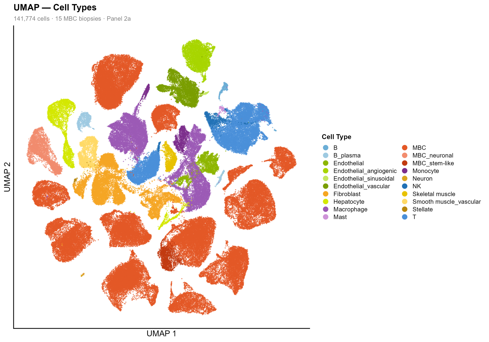
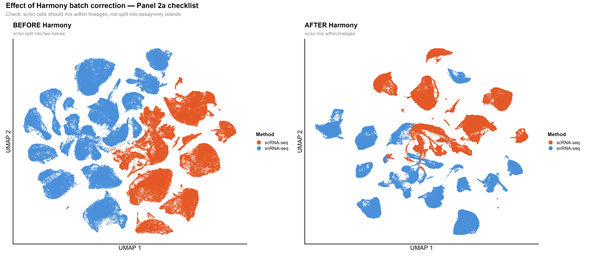
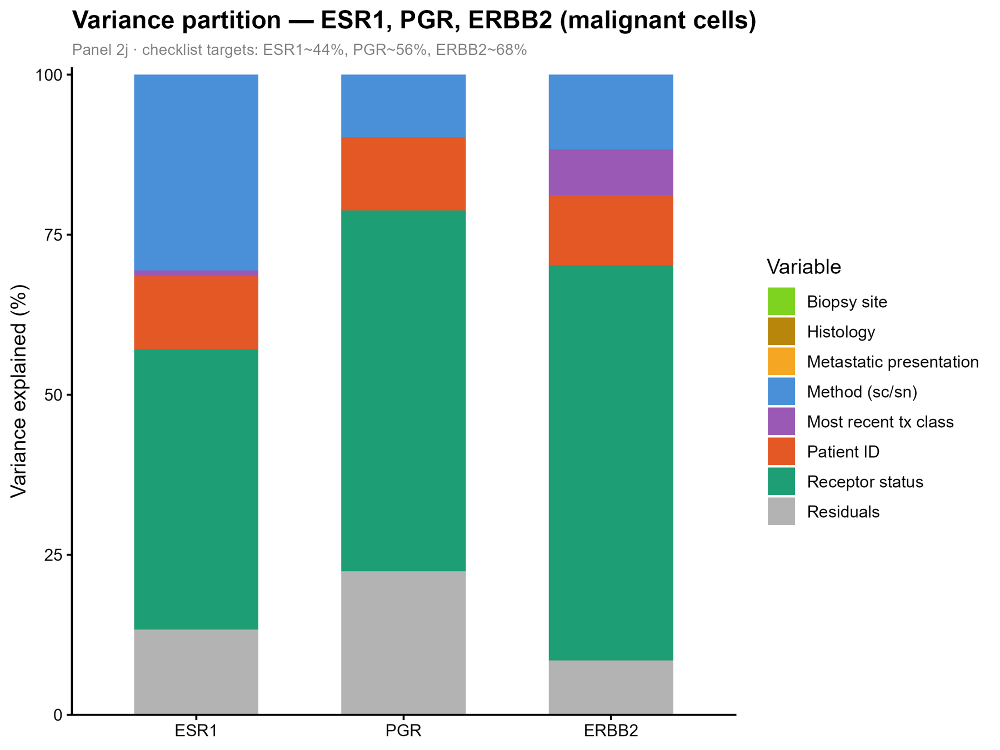
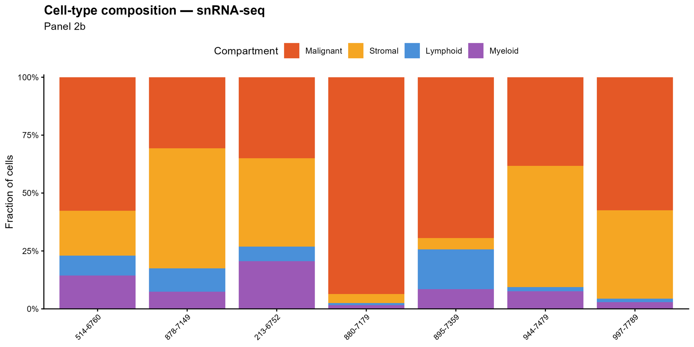

## TL;DR

When breast cancer spreads to the liver, does the cancer start to look like liver? I reanalysed 15 biopsies from a published single-cell atlas of metastatic breast cancer (Klughammer et al., *Nature Medicine* 2024). The answer is no. Cancer cells keep the identity of the **patient** they came from. Patient identity explained about **43%** of gene-expression variation in malignant cells, while biopsy site explained about **0.1%**. Code is on [GitHub](https://github.com/mdabrarfaiyaj/sc-snRNA-seq-metastatic-breast-cancer), with a [project website](https://mdabrarfaiyaj.github.io/sc-snRNA-seq-metastatic-breast-cancer/).

## Why I picked this

Before this project, I had only worked with bulk RNA-seq, where one sample gives one average expression profile. Single-cell data gives you thousands of profiles per sample, one per cell. I wanted to learn it on a real, published, high-quality dataset, and I set myself a small, achievable goal: reproduce **Figure 2** of the paper, using verified data at every step.

## The problem: four things that could shape a cancer cell

A metastatic breast cancer cell could be shaped by many things:

- **the patient** it came from (its own mutations and history)
- **the site** it spread to (liver, lymph node, bone...)
- **the receptor subtype** (HR+/HER2−, HER2+, triple-negative)
- **the lab method** used to profile it (fresh single cells or frozen single nuclei)

The last one is not biology at all. It's a technical effect, but it can be strong enough to fool you. So the question was: **which of these dominates?**

## An analogy: Bangladeshis abroad

Think of Bangladeshi families who moved to London, Dubai or Toronto. Do they become Londoners, Emiratis or Canadians? Some things change a little, like the weather they dress for. But the language at home, the food on Friday and the family habits mostly come with them.

Cancer cells are similar. Where they land changes a little. Where they came from changes much more.

## What I did

1. **Loaded a 3.9 GB dataset on a normal laptop** by reading only the cell information and coordinates, without loading the full expression matrix into memory.
2. **Verified the clinical information** (biopsy site, receptor status, treatment, PAM50 subtype) against the paper's supplementary tables and the authors' code.
3. **Plotted cells** with UMAP, coloured by cell type, patient, method and site.
4. **Corrected the technical effect** of the profiling method with **Harmony**.
5. **Built a "pseudobulk" profile** for the cancer cells in each biopsy (an average per sample), corrected with **ComBat**, and compared samples.
6. **Measured variance**: how much of the variation each factor explains.

### A mistake I'm glad I caught

In my first draft, I guessed each biopsy's site by looking at a figure in the paper. When I checked against the supplementary table, **my guess was wrong for all 15 samples**. I replaced everything with the verified values and kept the correction in my script history. Lesson learned: never estimate metadata from a picture when the table exists.

## What I found

### 1. Cancer cells cluster by patient

_Each dot is one cell. Immune and stromal cells form a few big shared groups; cancer cells form many small, separate islands._

Immune cells (T cells, macrophages) and stromal cells look similar in every patient, so they form a few large shared clusters. Cancer cells don't. They form many small islands, roughly **one per patient**. That makes sense: each tumour carries its own mutations and copy-number changes.

Using the paper's own variance values for malignant cells:

- **Patient identity:** about **42.7%** of gene-expression variance on average
- **Biopsy site:** about **0.1%**

The family keeps its language, wherever it moves.

### 2. The lab method was a big problem, and correction mostly fixed it

_Left: before correction, cells split by lab method. Right: after Harmony, immune and stromal cells mix, while cancer cells stay separated by patient._

Before correction, cells separated almost completely by **method** (fresh cells vs. frozen nuclei). That's a pure lab effect, and it would have dominated every plot. After Harmony, immune and stromal cells mixed across methods, as they should. Cancer cells stayed separated by patient, which is the expected result, because that separation is real biology.

A small method effect was still visible in the cancer-cell pseudobulk after ComBat. I traced it to an uneven mix of receptor subtypes between the two method groups in this small subset.

### 3. Receptor genes match the clinical labels

_Share of expression variance explained by receptor status for ESR1, PGR and ERBB2._

Doctors classify breast cancer by staining tissue for three receptors (ER, PR and HER2). Do the genes behind those receptors agree with the stains? Yes. Receptor status explained:

| Gene | My result | Paper |
|---|---|---|
| ESR1 (ER) | 43.8% | ~44% |
| PGR (PR) | 56.4% | ~56% |
| ERBB2 (HER2) | 61.7% | ~68% |

The ERBB2 gap probably comes from differences in which genes were filtered.

### 4. Every biopsy is different

_Each bar is one biopsy, split by cell type._

The share of cancer cells ranged from about **5% to over 90%** between biopsies. With only 15 samples, I can't say which clinical factor drives this, so I read this result as a direction, not a precise number.

## What this can't tell us

- **15 of 67 samples.** This is the spatially profiled subset, and some sites or subtypes have only one sample.
- **One biopsy per patient**, so I couldn't compare two sites from the same person (the paper's Figure 2c).
- I could only check the **malignant** variance numbers. The immune and stromal values need the full count matrix.
- This is **training and reproduction**, not new clinical findings.

## Conclusion

Metastatic breast cancer cells carry their patient's identity with them, much like a family abroad keeps its language at home. The biggest danger in this data wasn't biology at all. It was the lab method, which had to be corrected before anything else made sense. And the most useful habit I built was simple: **check every label against its source**.

## Citations

1. Klughammer J, Abravanel DL, Segerstolpe Å, et al. A multi-modal single-cell and spatial expression map of metastatic breast cancer biopsies across clinicopathological features. *Nature Medicine*. 2024;30:3236–3249.
2. Korsunsky I, et al. Fast, sensitive and accurate integration of single-cell data with Harmony. *Nature Methods*. 2019;16:1289–1296.
3. Johnson WE, Li C, Rabinovic A. Adjusting batch effects in microarray expression data using empirical Bayes methods. *Biostatistics*. 2007;8(1):118–127.
4. Single Cell Portal study SCP2702, Broad Institute.
