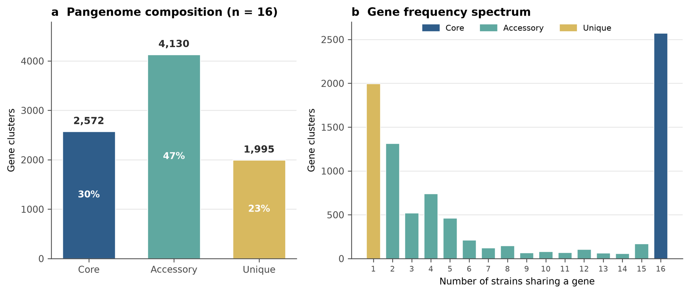
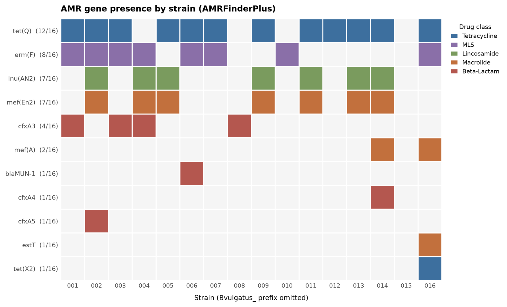
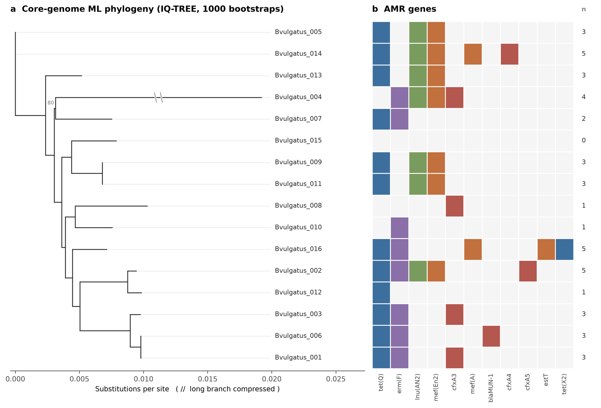

## TL;DR

Two bacteria with the same species name can carry very different genes. I compared 16 genomes of *Bacteroides vulgatus*, a common human gut bacterium, using a Nextflow pipeline I built. Only **30% of its gene families are shared by all strains**. The rest come and go. Antibiotic-resistance genes sit in that changing part, and they do not follow the family tree, which points to genes moving between strains. Code is on [GitHub](https://github.com/mdabrarfaiyaj/human-gut-bacterial-pangenome-analysis).

## The problem: one name, many genomes

We often talk about a bacterial species as if it were one thing. "*E. coli* does this." "*Salmonella* does that." But if you sequence ten strains of the same species, you get ten different gene lists.

The full set of genes found across all strains of a species is called its **pangenome**. It has two parts:

- **Core genome:** genes that (almost) every strain has. These usually do the basic jobs of staying alive.
- **Accessory genome:** genes that only some strains have. These often carry extra skills, like surviving an antibiotic.

My master's thesis is about resistance genes in *Aeromonas*, so I wanted to practice the same questions on a clean public dataset first:

1. Which genes are shared, and which vary?
2. Are resistance genes in the core or the accessory part?
3. Do resistance genes follow the family tree?

## An analogy: a neighbourhood kitchen

Think of 16 households on the same street in Dhaka. Every kitchen has rice, salt, oil and onions. That is the **core**: you cannot cook without it.

But open the spice boxes and they all differ. One house has panch phoron, another has saffron from a relative abroad, another has a special pickle. That is the **accessory** part. And spices don't only pass from parents to children. Neighbours share them.

Resistance genes behave like those spices.

## What I did

I wrote a **Nextflow DSL2 pipeline**, where each step is a separate module and the whole thing runs from one sample sheet:

1. **Check the inputs** and the assembly quality (seqkit)
2. **Annotate** every genome the same way (Prokka)
3. **Build the pangenome** (Panaroo, core = genes in at least 98% of strains)
4. **Find resistance genes** (AMRFinderPlus)
5. **Build a tree** from the core genes (IQ-TREE, 1,000 bootstraps)
6. **Make figures and a report** automatically

The genomes come from a public collection of 1,520 cultivated human gut bacteria (Zou et al., 2019). *B. vulgatus* had the largest pangenome in that study, with 66 genomes. My laptop could handle 16, so I picked the 16 best-assembled ones.

Half of the work was making the tools agree with each other. Panaroo needed an older Biopython and a small patch for NumPy. That's normal pipeline life, and it is written down in the README so the next person doesn't lose a day.

## What I found

### 1. Less than a third of the genes are shared

_Gene families in 16 B. vulgatus genomes, split by how many strains carry them._

| Category | Gene families | Share |
|---|---|---|
| Core (in ≥98% of strains) | 2,572 | 30% |
| Accessory (2–15 strains) | 4,130 | 47% |
| Unique (1 strain only) | 1,995 | 23% |
| **Total** | **8,697** | |

So 70% of this species' gene families are *not* in every strain. Even with only 16 genomes, almost 2,000 genes appear in just one strain. With all 66 genomes, that number would almost certainly grow.

### 2. Resistance genes live in the accessory genome

_Resistance genes per strain, coloured by drug class._

I found **11 different resistance genes**, and **none was present in all 16 strains**:

- **tet(Q)** (tetracycline): 12 of 16 strains, the most common
- **erm(F)** (macrolides and related drugs): 8 of 16
- **lnu(AN2)** and **mef(En2)**: 7 of 16 each
- several beta-lactam genes (cfxA3, cfxA4, cfxA5, blaMUN-1) in one to four strains

One strain carried no resistance gene at all.

### 3. Resistance does not follow the family tree

_Left: core-genome tree. Right: which resistance genes each strain carries._

This was the most interesting part. If resistance genes were simply inherited from a common ancestor, close relatives on the tree would share the same genes. They don't. **tet(Q)** shows up on almost every branch, and close cousins often have different gene sets.

There's also a neat pattern: **lnu(AN2) and mef(En2) always appear together**, in the same 7 strains. Two genes travelling as a pair across distant branches is what you would expect if they sit on the same piece of mobile DNA, like a plasmid or a transposon, that moves between strains. My pipeline can't prove that, but it points to the next question.

Back to the kitchen: the spices are not passed down from grandparents. Neighbours are sharing them.

## What this can't tell us

- **Only 16 of 66 genomes**, chosen for good assembly quality, so the sample is biased towards cleaner strains.
- **Draft assemblies** can split or miss genes, which makes the accessory genome look bigger than it is.
- **Genes are not phenotypes.** A resistance gene in the DNA doesn't prove the bacterium resists the drug in a lab test.
- **One species, one population** (healthy donors in China), so the results don't automatically apply to other gut bacteria.
- I didn't check *where* the resistance genes sit (chromosome or plasmid). That is exactly what my thesis does for *Aeromonas*.

## Conclusion

A species name tells you less than you think. In *B. vulgatus*, most genes are optional extras, and the resistance genes are among them, scattered across the tree as if they were borrowed rather than inherited. Like spices on a Dhaka street, the interesting stuff moves between neighbours.

## Citations

1. Zou Y, Xue W, Luo G, et al. 1,520 reference genomes from cultivated human gut bacteria enable functional microbiome analyses. *Nature Biotechnology*. 2019;37:179–185.
2. Tonkin-Hill G, et al. Producing polished prokaryotic pangenomes with the Panaroo pipeline. *Genome Biology*. 2020;21:180.
3. Seemann T. Prokka: rapid prokaryotic genome annotation. *Bioinformatics*. 2014;30(14):2068–2069.
4. Feldgarden M, et al. AMRFinderPlus and the Reference Gene Catalog facilitate examination of the genomic links among antimicrobial resistance, stress response, and virulence. *Scientific Reports*. 2021;11:12728.
5. Minh BQ, et al. IQ-TREE 2: new models and efficient methods for phylogenetic inference in the genomic era. *Molecular Biology and Evolution*. 2020;37(5):1530–1534.
