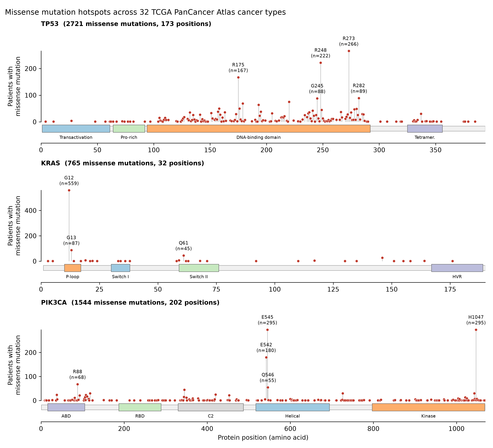
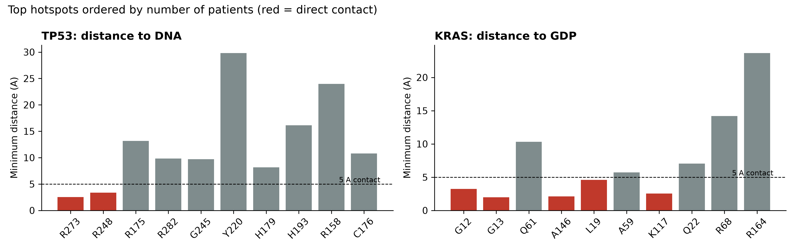
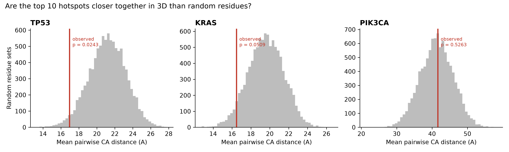
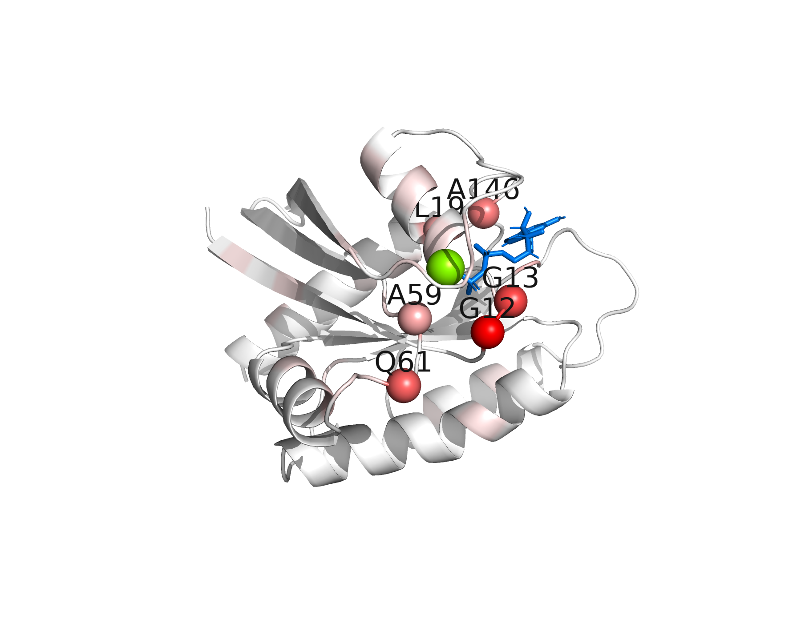

## TL;DR

Tumors carry thousands of mutations, but only a few actually drive cancer. I took about 5,000 tumor mutations in three famous cancer genes (TP53, KRAS and PIK3CA) from 32 cancer types and placed them on the 3D structures of the proteins. The mutations are not random. KRAS is hit at a tiny number of spots around its "on/off" pocket, while TP53 is hit almost everywhere in its DNA-binding domain. The 3D view also shows *how* each mutation breaks the protein. Code and results are on [GitHub](https://github.com/mdabrarfaiyaj/cancer-mutation-3d-hotspots).

## Why I picked this

<!-- EDIT: change this section if your real reason is different -->
My master's thesis is about bacteria, more specifically, where antibiotic-resistance genes sit in *Aeromonas* genomes. After months of that, one idea kept bothering me: a bacterium survives an antibiotic because a few letters in its DNA changed. A cancer cell survives the body's own controls, and often survives cancer drugs too, for exactly the same kind of reason.

I had already played with cancer data in a single-cell breast cancer project, and I had done some protein-structure training with CCDC. So I wanted a project that joined the two: take mutations from real patients and look at them not as letters in a table, but as dots on a real 3D protein.

## The problem: thousands of mutations, only a few matter

A tumor genome collects mutations all the time: from smoking, from UV light, from simple copying mistakes when cells divide. Most of these do nothing. They are **passengers**. They happened in the same cell, but they don't help it grow.

A few mutations are **drivers**. They give the cell an advantage, so the cell (and the mutation) gets selected and expands. The big question in cancer genomics is how to tell the two apart.

One strong clue is repetition. If the same position is mutated in hundreds of unrelated patients, that is not luck. Something about that spot matters.

A second clue, and the one I wanted to test, is **3D location**. A protein is not a straight line. It folds. Residue 175 and residue 248 are far apart in the sequence but close together in the folded protein. And proteins do their jobs on 3D surfaces: a face that grabs DNA, a pocket that holds a small molecule. If mutations from many patients land on the same 3D spot, that spot is probably doing something important.

## Meet the three proteins

Before the results, here is a quick introduction to the three proteins, because they behave very differently.

**TP53** is often called the guardian of the genome. When a cell's DNA gets damaged, p53 binds to DNA and switches on genes that stop the cell from dividing, repair the damage, or make the cell kill itself. Lose p53, and damaged cells keep dividing.

**KRAS** is an on/off switch for growth signals. When it holds a molecule called GTP, it is **on** and tells the cell to grow. It switches itself **off** by cutting GTP down to GDP.

**PIK3CA** is an enzyme in another growth pathway. It is the most commonly mutated gene in breast cancer.

This gives the two classic kinds of cancer gene:

- **Oncogene** (KRAS, PIK3CA): the mutation makes the protein *too active*. One bad copy is enough.
- **Tumor suppressor** (TP53): the mutation makes the protein *stop working*.

## The analogy: Dhaka traffic

If you have been to Dhaka, you know traffic is a constant negotiation. Two things keep it from becoming total chaos: traffic lights and traffic police.

**KRAS is like a traffic light.** It works fine unless a very specific wire jams, and then it's stuck on green forever. Cars just keep going. There are only a few wires you can jam to do that, so if you look at a thousand broken lights, you find the same few wires again and again.

**TP53 is like the traffic police officer.** There are a hundred ways for him to stop doing his job: he is sick, his whistle is broken, he is on his phone, it's raining and he went for tea. Any of these works. So if you look at a thousand failed officers, the reasons are spread all over the place.

Keep that picture in mind for the results.

## What I did

I kept the pipeline simple, with four Python scripts (all on [GitHub](https://github.com/mdabrarfaiyaj/cancer-mutation-3d-hotspots)):

1. **Get the mutations.** I downloaded every missense mutation in TP53, KRAS and PIK3CA from all 32 TCGA PanCancer Atlas studies using the cBioPortal API. A missense mutation changes one amino acid, so I can point to the exact residue on the structure. Each patient was counted only once per position, since one patient can have more than one sample.
2. **Find the hotspots.** I counted patients per residue and drew lollipop plots.
3. **Go 3D.** I put those counts onto protein structures:
   - TP53 bound to DNA (PDB 1TSR)
   - KRAS bound to GDP (PDB 4OBE)
   - PIK3CA from an AlphaFold model

   Then I measured how far each hotspot sits from the DNA or the GDP.
4. **Test it.** I checked whether the top hotspots sit closer together in 3D than random residues would.

## What I found

### 1. The traffic light vs. the traffic police

_Each stick is a protein position; its height is the number of patients with a mutation there._

Look at KRAS (middle). Of 765 KRAS missense mutations, **73% sit at a single residue, G12**. Add G13 and Q61 and you have almost all of them. Only **32 positions** are hit at all.

Now look at TP53 (top). It has 2,721 missense mutations spread over **173 positions**, nearly the whole DNA-binding domain. There are tall peaks (R273, R248, R175), but there is also a dense forest of smaller ones.

Traffic light: a few specific wires. Traffic police: a hundred ways to fail.

There is one honest twist. Some TP53 peaks, like R175, R248 and R273, sit at "CpG" spots in DNA that mutate more easily for chemical reasons. So part of their height is "easy to hit," not only "useful to the tumor." I didn't correct for this, and I come back to it in the limitations.

### 2. Two ways to break TP53

_Distance of each hotspot to DNA (TP53) or GDP (KRAS). Red bars touch the partner directly._

This was my favourite part. The two most common TP53 hotspots, **R273 (2.5 Å)** and **R248 (3.4 Å)**, physically touch the DNA. When they are mutated, the protein folds fine, but it can no longer grip DNA. Think of a hand with no fingers.

But **R175** is 13 Å away from the DNA, and **Y220** is almost 30 Å away. They break p53 differently. R175 sits next to the zinc ion that holds the domain together, so mutating it makes the protein misfold. The whole hand collapses. Two more top hotspots, C176 and H179, are part of that same zinc site.

So the "same" tumor suppressor is broken in two different ways: lose the contact, or lose the shape.

### 3. KRAS hotspots surround the switch

In KRAS, **G12 (3.2 Å), G13 (2.0 Å) and A146 (2.1 Å)** all touch GDP. They line the pocket where the on/off switch happens. Mutations here stop KRAS from cutting GTP, so it stays on. The traffic light is stuck on green.

**Q61** confused me at first. It's a famous hotspot, but it sits 10 Å from GDP in my structure. The reason is that Q61's job is to help cut the *third* phosphate of GTP, and GDP doesn't have one. My structure shows KRAS in the "off" state, where Q61 has moved away. It's the wrong snapshot to see Q61 at work, which is a nice reminder that a structure is one photo, not the whole movie.

### 4. Do hotspots cluster in 3D?

_Grey: average distance between 10,000 random sets of residues. Red line: the real hotspots._

I took the 5 most mutated residues in each protein and measured their average distance from each other. Then I picked 5 random residues 10,000 times and did the same.

- **TP53:** the hotspots are 13.3 Å apart vs. 21.2 Å for random sets (p = 0.013).
- **KRAS:** 12.8 Å vs. 19.5 Å (p = 0.018).
- **PIK3CA:** no difference at all (p = 0.46).

A p-value of 0.013 means only about 1.3% of random sets were as tightly packed as the real hotspots. So in TP53 and KRAS, the top hotspots are clustered in 3D far more than chance would give. When I used the top 10 instead of the top 5, the signal got weaker (KRAS was no longer significant), because the extra residues are rarer mutations scattered elsewhere.

### 5. PIK3CA: not a failure

At first, PIK3CA's "no clustering" looked like a failed result. It isn't. PIK3CA has **two** hotspot regions far apart from each other:

- the **helical domain** (E542K, E545K)
- the **kinase domain** (H1047R)

My test looks for one tight cluster, and two distant ones average out to "random." Those two regions are thought to switch PIK3CA on by two different routes. So the result actually says something real, and it also shows the limit of my simple test.

### 6. Why this matters for treatment

{: width="480" .right}

At G12, the most common KRAS change in my data is G12D (197 patients), followed by G12V (165) and **G12C (101)**. G12C is the one with approved drugs (sotorasib and adagrasib). Cysteine has a reactive sulfur atom, and these drugs form a permanent bond with it, locking KRAS in the "off" state. Aspartate (D) has no such handle, which is a big reason G12D has been much harder to drug, even though it is more common.

TP53 has its own story. **Y220C** (75 patients here) leaves a small cavity on the protein's surface, which makes p53 unstable. Researchers designed molecules that fill that cavity and stabilize the protein again. One of them, rezatapopt, is in clinical trials. A broken tumor suppressor is usually impossible to fix with a drug, so a druggable pocket is rare and exciting.

Both stories come straight from structure: *where* the mutation sits decides *whether* we can target it.

## Try it yourself

You can rotate the proteins and hover over each mutated residue to see how many patients carry it:

<iframe src="https://mdabrarfaiyaj.github.io/cancer-mutation-3d-hotspots/results/interactive/TP53_3D.html" width="100%" height="620" style="border:1px solid #ddd; border-radius:8px;" loading="lazy" title="Interactive TP53 3D view"></iframe>

Other proteins: [KRAS](https://mdabrarfaiyaj.github.io/cancer-mutation-3d-hotspots/results/interactive/KRAS_3D.html) · [PIK3CA](https://mdabrarfaiyaj.github.io/cancer-mutation-3d-hotspots/results/interactive/PIK3CA_3D.html)

## What this can't tell us

I want to be honest about the limits, because they matter:

- **No background mutation rate.** I counted raw patients. Some DNA positions mutate more easily than others, so part of a hotspot's height may come from that, not from selection. Published tools like HotMAPS and OncodriveCLUST correct for this; I didn't.
- **One snapshot per protein.** KRAS is shown only in its "off" state, which hides Q61's role. PIK3CA is shown without its partner protein p85, which is exactly where the helical mutations act.
- **Simple statistics.** One test, no correction for multiple testing, one cohort (TCGA). Treat the p-values as exploratory, not as proof.

If I had another month, I would run the same pipeline on about 20 cancer genes, add a background mutation model, and test properly whether oncogenes cluster more than tumor suppressors.

## Conclusion

Cancer mutations are not sprinkled randomly over proteins. In oncogenes like KRAS, they pile up on a few residues that jam the switch, like a traffic light stuck on green. In tumor suppressors like TP53, they spread over the whole working surface, because there are a hundred ways to stop a traffic police officer from doing his job. And looking in 3D tells you more than where a mutation is. It hints at *how* it breaks the protein, and sometimes whether a drug can fix it.

So next time you see a long list of tumor mutations, ask yourself: is this a broken traffic light, or a missing traffic police officer?

## Citations

1. Cerami E, et al. The cBio Cancer Genomics Portal. *Cancer Discovery*. 2012;2(5):401–404.
2. Gao J, et al. Integrative analysis of complex cancer genomics and clinical profiles using the cBioPortal. *Science Signaling*. 2013;6(269):pl1.
3. Hoadley KA, et al. Cell-of-origin patterns dominate the molecular classification of 10,000 tumors from 33 types of cancer. *Cell*. 2018;173(2):291–304.
4. Cho Y, Gorina S, Jeffrey PD, Pavletich NP. Crystal structure of a p53 tumor suppressor–DNA complex. *Science*. 1994;265(5170):346–355.
5. Hunter JC, et al. In situ selectivity profiling and crystal structure of SML-8-73-1, an active site inhibitor of oncogenic K-Ras G12C. *PNAS*. 2014;111:8895–8900.
6. Jumper J, et al. Highly accurate protein structure prediction with AlphaFold. *Nature*. 2021;596:583–589.
7. Joerger AC, Ang HC, Fersht AR. Structural basis for understanding oncogenic p53 mutations and designing rescue drugs. *PNAS*. 2006;103(41):15056–15061.
8. Skoulidis F, et al. Sotorasib for lung cancers with KRAS p.G12C mutation. *NEJM*. 2021;384:2371–2381.
9. Jänne PA, et al. Adagrasib in non–small-cell lung cancer harboring a KRAS G12C mutation. *NEJM*. 2022;387:120–131.

The full reference list, including data and software, is in the [project README](https://github.com/mdabrarfaiyaj/cancer-mutation-3d-hotspots).
